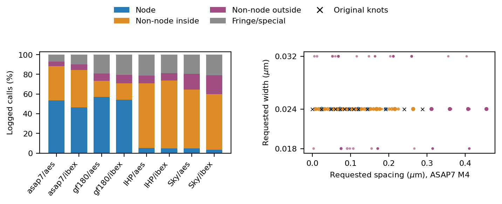
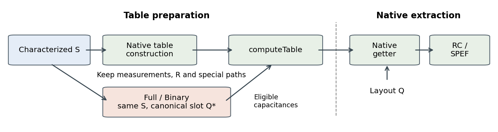
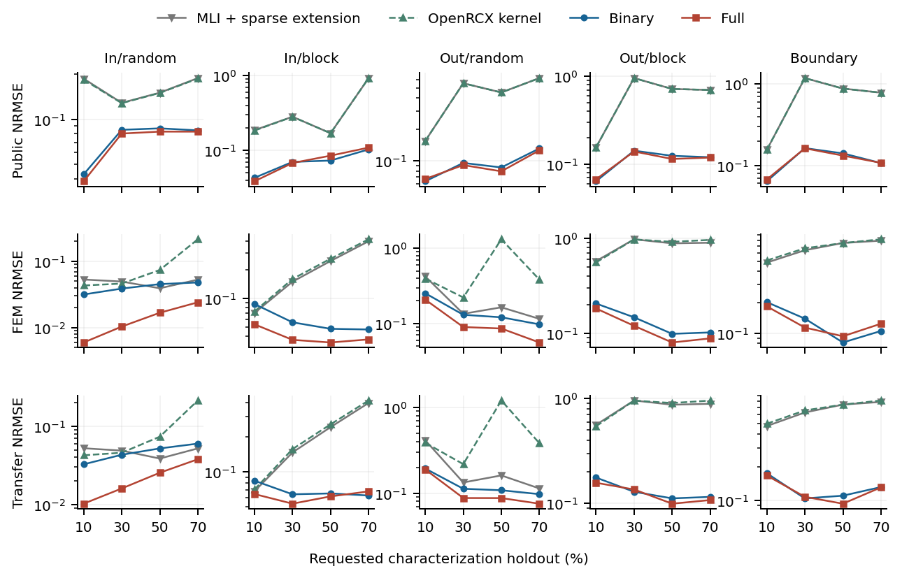

<!-- GENERATED by sync_markdown.py; edit main.tex, not this reading copy. -->

# Learning to Populate Capacitance Evaluation Tables for Rule-Based Parasitic Extraction

## Abstract

Rule-based parasitic extraction evaluates geometries between a finite set of characterized interconnect patterns. We condition a numerical anchor and Transformer residual on supplied capacitance observations, combining numerical and neural corrections through component-wise gates. Learning populates internal evaluation tables before native lookup and parasitic-network assembly. We compare specified production-related interpolation kernels under common characterization support, distinguish physical template accuracy from native extraction fidelity, and evaluate 10/30/50/70% characterization holdout. A census of two native getters records 9.89 million calls, of which 55.77% request non-node geometries. Full improves over both kernel controls in all 60 controlled coverage cells, whereas numerical interpolation remains more accurate on 71 fully supported layout-parameterized templates. Native-value pass-through and repeated extraction validate the compute-table interface, with preparation and extraction costs reported separately.

## Introduction
Rule-based parasitic extraction separates process characterization from layout evaluation. Capacitances for representative interconnect geometries are encoded in models or lookup structures; extraction evaluates these models for encountered geometries [1, 2]. OpenRCX calibrates rules from reference parasitics and evaluates them using coupling distance and routing context [3, 4]. A routed layout need not coincide with the characterization nodes. The resulting accuracy depends both on pattern coverage and on how the nonlinear geometry–capacitance response is represented between available samples [5].

Increasing characterization density requires additional reference computation and storage [2]. We instead hold the supplied samples fixed and study their use for uncharacterized queries. Previous work automates pattern/formula construction [6], learns capacitance or matrix predictors [2, 5, 7, 8], and explores geometry and layer thickness [1]. Our predictor combines current observations, numerical candidates and source-trained residuals. The intended advantage is conditional accuracy under restricted coverage; dense, smooth supports may already favor simple interpolation.

The deployment interface matters as much as prediction cost. Direct neural evaluation is slower than a native lookup. We therefore prepare learned values in the internal compute table, retaining the original getter and downstream RC assembly. This interface differs from exporting predictions at existing characterization-file nodes. Both configurations are evaluated and named separately.

The contributions are (i) characterization-conditioned residual prediction with binary and numerical–neural gates; (ii) a finite-distance compute-table population interface that preserves measurement entries, resistance and native query assembly; and (iii) matched production-kernel comparisons connecting coverage sensitivity, measured layout queries, independent template references and extraction costs. The evaluation retains conditions where numerical or simpler learned methods are better.

## Problem and Related Work
### Rule-based capacitance evaluation
A rule is identified by process/corner, pattern family and layer context. Characterization supplies geometry–capacitance samples. A preparation stage builds internal lookup structures, after which extraction maps a layout request to a pattern/width and evaluates the corresponding distance response. Native quantization and boundary behavior are part of this algorithm; equality of a floating-point interpolation formula does not imply equality of the complete evaluator.

### Measured off-grid demand
Across two instrumented OpenRCX getters on eight unchanged routed layouts, we record 9,888,586 calls and 19,562 unique rule/geometry keys. The calls comprise 2,696,515 node hits, 4,547,424 non-node requests inside the selected width slice, 967,755 outside it, and 1,676,892 fringe/special requests. Raw non-node requests account for 55.77% of all logged calls and 67.16% of finite-distance calls (Fig. 1). Native width mapping and compute-grid quantization send 849,663 raw non-node requests to effective characterization nodes.

Figure 1. Measured non-node demand. Left: occurrence-weighted query classes over two logged capacitance getters on eight fixed layouts. Right: ASAP7 M4 requests and original knots; marker area reflects log occurrence. Counts exclude resistance, five-argument diagonal getters and later assembly; they are neither capacitance nor runtime weights. Raw and effective node identities differ under native mapping.

The trace preserves SPEF electrical records on all layouts. It establishes the frequency of non-node evaluation in these getters, not the fraction of all PEX work. Characterization holdout is a different quantity: it varies the available information rather than measuring runtime request frequency. We evaluate all four requested holdout levels without equating them to the census percentages.

### Problem formulation and kernel scope
For context $c$, available observations $S=\{(x_i,y_i)\}$ and query coordinates $Q$, the estimator satisfies

$$

\widehat y_Q=F_\theta(S,Q,c),\qquad \widehat y(x_i)=y_i\ (x_i\in S).

$$

An off-grid geometry need not lie outside support. Inside-support classification requires affine-space and hull membership; incompatible topologies or outputs are excluded explicitly. Only S values enter prediction; query reference values enter scoring.

The primary algorithmic comparison is the pinned OpenRCX finite-distance kernel and specified multilinear interpolation (MLI). Specified MLI implements the supplied xRC mathematical core. This comparison concerns the interpolation operator; commercial binaries and product-specific boundary policies are outside its scope. In $d$ dimensions,

$$

\widehat y(x)=\sum_{\epsilon\in\{0,1\}^d}y_\epsilon
 \prod_{j=1}^d t_j^{\epsilon_j}(1-t_j)^{1-\epsilon_j}.

$$

Complete cells require $2^d$ vertices. Sparse-support completion and boundary clamping are separately declared extensions, not attributed to xRC. Physical data have rank one or two; four-dimensional evaluation is an implementation test only. OpenRCX comparison retains native width selection, integer geometry and four-unit compute bins; a continuous-distance variant isolates quantization effects. General numerical predictors are component controls.

### Related models and interfaces
AttentionCap predicts capacitance matrices from conductor/material tokens [7]; Flash-CNNCap predicts window contributions in a three-dimensional DEF-to-SPEF workflow [8]. Our component-supervised AttentionCap adaptation tests a specified observation budget and fitting recipe, rather than a general limit of matrix architectures. AttentionCap itself supports partial matrix-row supervision. Flash-CNNCap's 3D window task is not converted into a mismatched 2D speed ranking.

ResCap corrects initial physical estimates [9]; hybrid PEX selects extraction methods by window [10]. Here the anchor uses current observations and fusion acts within a rule. CNPs [11] and attentive neural processes [12] provide conditional regression interfaces. CNP is evaluated as such, not categorized as a field solver.

## Estimator and Compute-Table Preparation
### Observation-conditioned residual fusion
The anchor uses piecewise-linear interpolation for rank-one support, simplex interpolation inside higher-rank support, and nearest-observation fallback outside or for degeneracy. Tokens encode geometry, context/materials, observation status, observed values and the anchor. Source-fitted scaling remains fixed. The observation indicator distinguishes an unobserved placeholder from an observed zero.

With representation $h_i$, anchor $b_{i,k}$ and correction candidates $\Delta_{i,e,k}$, predictions are

$$

\widehat y_{i,k}=\left[b_{i,k}+\sum_{e\in\mathcal E_i}\pi_{i,e,k}\Delta_{i,e,k}\right]_+ .

$$

The gate reads the representation and support density, distance, span, hull membership and correction disagreement. Binary combines zero and raw neural correction. Ungated adds the raw neural correction directly. Full additionally uses applicable PCHIP, aligned-width interpolation, six RBF-GP configurations and an envelope-clipped neural correction. These candidates are existing algorithm components; all applicable branches execute before fusion. Affine/IDW controls are not retrospectively described as model ablations.

The encoder has two layers, four heads and width 64; the gate hidden width is 32. Matched Full/Binary/Ungated training uses the same source pools, residual initialization, optimizer, update counts and three seeds. AdamW uses learning rate $2\times10^{-4}$ and weight decay $10^{-4}$; a source-scaled Huber loss supervises withheld components. Training masks span random, block, boundary and eligible whole-width patterns at 10/30/50/70% holdout. The query–query attention makes outputs batch-conditioned.

### Populating the native evaluation structure

Figure 2. Learning populates eligible internal capacitance slots during preparation. The original constructor supplies the complete native table; the hook changes only covered coupling/fringe values. Real observations, resistance and special returns remain native. Layout queries retain the original getter and RC assembly.

Figure 2 separates preparation from native queries. The preparation hook runs immediately after OpenRCX constructs a distance compute table and before getters use it. Keys include process/corner, rule/configuration identity, family, layers, mapped width, slot index, represented separation, output components and units. Predictions are evaluated at the coordinate represented by the slot, not at an arbitrary raw request. All S values remain real observations; generated values are never fed back as support.

The evaluated scope is finite, non-sentinel OVER/UNDER/OVERUNDER tables with uniquely matched source-held-out rules. Measurement-bin collisions, special tails, unsupported paths and resistance remain native. Boundary paths that return the measure table are preserved. Only coupling and fringe compute fields are written. Full-grid preparation uses deterministic coordinate order and Q chunks of 32; no query-dependent Transformer support states are cached.

We compare unmodified extraction, interface-disabled extraction, native-value pass-through, Binary and Full injection. A separate trace build checks getter values; the release build leaves getter bodies unchanged. Inventories must match across both designs of each process before claiming design-independent grid reuse. The pinned public API defers loading until extraction, so the first inventory extraction is charged to preparation. This is explicit measured overhead, not a free rule-only operation.

## Experimental Setup
The public inventory contains 1,713 tables, with 1,051/246/340 fitting/selection/confirmation tables. Native holdout excludes 84 tables from source fitting and selection. FEM fitting/selection/confirmation counts are 16/24/16; transfer uses 8/12/8, training and selecting on FreePDK15 and evaluating ASAP7. Training/confirmation FEM grids have 153/128 points. Full/Binary/Ungated use 24k public and 12k FEM/transfer updates; MLP/CNP and adapted AttentionCap use 3k source updates. All reported learned completion predictions average three members.

*Coverage sensitivity* evaluates random, block and boundary masks at 10/30/50/70%, with mask seeds 11/29/47/71/101. Every method shares S/Q within a condition. Actual support/query counts, rank, inside/outside status and identical rounded episodes are retained. Complete-cell MLI coverage is recorded before scoring; missing-cell results use the labeled support-only extension. Common kernel feasibility is defined geometrically. Changing holdout may change Q, so curve slopes are not causal effects on a fixed query population. The separate fixed-Q budget study uses $B=4,8$ for public and $B=4,8,16,32,64$ for FEM/transfer.

*Numerical/learning controls* retain Anchor and a source-validation-selected GP, plus affine, PCHIP and IDW analyses. MLP fits a fixed support once for 200 source-selected steps; CNP conditions without target updates. Adapted AttentionCap retains its official Transformer/symmetric head [13], maps recorded conductors/materials and fits the same three components for 50 source-selected steps. Equal target support does not imply equal source-training opportunity. Full/Binary/Ungated are the matched architectural controls.

*Independent physical queries* reuse 71 formal layout-parameterized templates from six ASAP7 M4/M5 contexts, with all 153 characterized samples per context. Logged widths/spacings parameterize symmetric equal-width side conductors, finite adjacent grounded planes and an exterior grounded boundary. These are not arbitrary full-layout cross sections. Ground and summed lateral components are projected from independently solved Maxwell matrices in F/m. Geometry, material, boundary and projection checks align S and Q. Coarse/fine/domain checks give macro uncertainty 0.00016; twelve node controls reproduce reused matrices exactly.

*Native studies* use AES/Ibex on ASAP7, GF180, IHP SG13G2 and Sky130HS using OpenROAD `0b54bb3203`, with unchanged ODBs, rules, libraries and constraints. New computeTable injection uses full supplied characterization; the existing fixed-node export study uses B=8 and seed11 and remains separate. Native full-rule references measure fidelity. They do not establish alignment of native calibration physics with the FEM templates.

For component group $g$, $E_g=\sqrt{\sum_Q(\widehat y-y)^2/\sum_Q y^2}$. Zero-energy groups are excluded from normalized error. Coverage results pool errors by process/family/component within each mask, macro-average groups, then average masks. Physical results macro-average family/component groups on identical queries. Fixed-Q budget scores pool data seeds before group normalization; support-protocol scores are mean-member, group-balanced quantities, not ensembles. Full details and all completed controls are in the expanded treatment.

## Results
### All four characterization holdouts

Figure 3. Coverage sensitivity: all 10/30/50/70% holdouts, three domains and five support/protocol conditions. Mean-mask macro NRMSE on common feasible S/Q; Full and Binary average three matched members. MLI-ext. identifies the specified core plus declared sparse-support/boundary extension. No curve uses the native census to set holdout. Complete-cell coverage, rounded duplicates and full numerical controls are reported separately.

Figure 3 includes all 60 domain–holdout–condition cells. Full has lower error than the OpenRCX kernel, MLI with the explicit extension, and Binary in 60, 60, and 49 cells, respectively. The kernels share 21,840/21,840 feasible support/query episodes. Complete MLI cells cover 20.7% of requested queries across the sweep; the remainder use the declared boundary or sparse-support extension. The inventory flags 11,245 repeated rounded S/Q episodes rather than treating them as additional independent evidence. Detailed cells and all numerical controls are retained in the expanded tables.

At 30% characterization holdout, Full improves over Binary in 13/15 conditions and all five FEM conditions. FEM in-support random/block errors are 0.0103/0.0366 versus Binary 0.0387/0.0560. Public Full/Binary block errors are 0.0678/0.0701, while Ungated reaches 0.0645. These observations justify component analysis rather than a universal benefit from a larger gate.

### Production kernels on matched physical support

Table I. Same 71 physical template queries and 153 S/context. The OpenRCX kernel uses FEM-characterized scalar projections, native width mapping and compute bins. Compute-table rows score values retrieved after learned slot generation, with their own canonical Q protocol. P95 pools the two nonzero components.

| Method | NRMSE | P95 (pF/m) |
| — | — | — |
| OpenRCX kernel | 0.01072 | 0.799 |
| Specified MLI | 0.00452 | 0.240 |
| Binary | 0.02218 | 1.337 |
| Full | 0.01675 | 1.024 |
| Binary compute table | 0.02901 | 1.473 |
| Full compute table | 0.02447 | 1.554 |

Table I drives both production-related kernels with the same FEM-characterized samples. Specified MLI obtains NRMSE 0.00452; the mapped/quantized OpenRCX kernel obtains 0.01072. Its ideal continuous-distance counterpart obtains 0.00635, isolating one implementation effect without introducing width interpolation. Full/Binary values retrieved through populated compute tables obtain 0.02447/0.02901. Full does not improve over the native kernel on this complete-support cohort. These values use a complete-slot preparation protocol and native mapping, so direct-query errors cannot be substituted for them. Extracted pinned function bodies agree with the Python evaluator, and native-value pass-through preserves the kernel outputs.

Table II. Numerical and conditional controls on the same fully supported templates. Times reuse Q-limit32, three-member measurements on one CPU thread; target fitting/loading is separate. Selected GP is frozen on source validation.

| Control | NRMSE | Warm ms/Q |
| — | — | — |
| Anchor | 0.00451 | 0.788 |
| CMI extension | 0.00452 | 0.923 |
| Selected GP | 0.05371 | 0.316 |
| Local affine | 0.05254 | 0.232 |
| Ungated | 0.02688 | 2.051 |
| Binary | 0.02218 | 2.110 |
| Full | 0.01675 | 3.706 |
| Adapted MLP | 0.01889 | 0.025 |
| CNP | 0.16575 | 0.155 |
| Adapted AC | 0.70695 | 0.230 |

Anchor is more accurate than direct Full/Binary at 0.00451 versus 0.01675/0.02218 (Table II). This is an applicability limit on a full-support cohort, not evidence that the estimator repairs missing PDK files. In fixed-Q sparse-support comparisons, Full reaches public NRMSE 0.0708/0.0609 at B=4/8 versus Binary 0.0793/0.0648. At FEM B=4, adapted MLP is better than Full (0.0515 versus 0.1233); at B=64 they reach 0.0248/0.0250, with GP 0.0280. Transfer B=64 favors MLP/GP (0.0264/0.0271) over Full 0.0386. Adapted AttentionCap and CNP remain in the full learning-control tables; their task-specific results do not establish a general architectural inability to interpolate.

### Native interface and complete extraction cost

Table III. New computeTable path, Full: full-rule net-C fidelity, mean extraction ratio over three release runs, external cold preparation, PEX and SPEF wall seconds. Preparation includes inventory acquisition and loading; native table build/injection remains within extraction. Output and STA costs are separately retained.

| Layout | C err. | Prep. | PEX | SPEF | $T/T_0$ |
| — | — | — | — | — | — |
| asap7/aes | 0.00426 | 5.41 | 2.05 | 0.49 | 0.991 |
| asap7/ibex | 0.00516 | 5.41 | 3.30 | 0.72 | 1.020 |
| gf180/aes | 0.00030 | 8.39 | 2.45 | 0.52 | 1.031 |
| gf180/ibex | 0.00020 | 8.39 | 2.73 | 0.52 | 0.999 |
| IHP/aes | 0.05656 | 13.99 | 2.00 | 0.40 | 1.035 |
| IHP/ibex | 0.05477 | 13.99 | 3.10 | 0.66 | 1.029 |
| Sky/aes | 0.00382 | 8.48 | 2.43 | 0.56 | 1.017 |
| Sky/ibex | 0.00233 | 8.48 | 2.29 | 0.58 | 1.024 |

The new interface populates 49,657 eligible finite slots across four rule libraries. Native-value pass-through preserves traced getter returns and electrical SPEF records on all eight layouts. Full changes 924,647 traced returns; covered returns match injected values, and resistance/uncovered returns remain identical. Table III reports the newly measured path: across 120 release runs, the Full extraction/original ratio ranges from 0.991 to 1.035. Including inventory, input/model/support preparation and process-startup residual, first-design PEX overhead ranges from 161.1% to 670.4%. SPEF output and STA are measured separately and are not used to dilute this denominator. Values below one are repeat-run variation, not a stable acceleration claim.

Full's net-C fidelity error ranges from 0.00020 to 0.05656. The largest errors occur on IHP, with worst-slack changes of 74.4/147.4 ps for AES/Ibex. These are deviations from native full-rule extraction, not improvements against an independent field reference.

The fixed-node rule-export configuration has a different support and deployment contract. Across 96 release runs, Full's extraction/original ratio is 0.983–1.047. Four-library B=8 prediction/export costs 0.70/0.67/0.91 s for CMI/Binary/Full, plus 0.88 s shared setup. Full improves net-C and worst-slack fidelity over CMI in all 16 layout–budget cells, but improves over Binary in only six/four cells; Binary has lower P99 endpoint error in ten. These fidelity and timing results are retained without relabeling them as computeTable injection.

\newpage
### Reused runtime and conditional limitations
On one pinned Xeon Gold 6530 thread, three warmups and 20 interleaved blocks measure warm evaluation, with distinct Q=1/8/32 accuracy. Direct Full/Binary/Anchor at Q limit32 cost 3.706/2.110/0.788 ms/query. Full's actual Q=1 mean is 40.97 ms. Retained-fit MLP costs 0.025 ms/query after 14.03 s fitting across six contexts; adapted AttentionCap costs 0.230 ms/query after 11.27 s fitting, at NRMSE 0.70695. No fit uses query labels. Source training is a separate supplied-model cost; recorded final-stage times are retained in the expanded treatment, while complete source-label and training costs are unavailable.

Resident single-RHS fine FEM costs 3.719 s/query including remeshing and factorization; 213 solves agree with certified matrix rows within $1.5\times10^{-15}$ scaled difference. Predictor errors exceed reference uncertainty, so these times do not establish an equal-accuracy speedup. The 1.72 ns validated cache-hot getter counterpart excludes width/context resolution and assembly; it is not full PEX latency.

Global attention makes predictions depend on Q. Compute-table preparation therefore defines and scores its complete-slot batching separately from direct query replay. Support-protocol continuation can also trade sparse accuracy for retention: the matched low-budget study narrows Full's average advantage over Binary from 0.014088 to 0.002939, with denser-support degradation. The expanded treatment retains all process, budget, learning and timing controls. No query-reference-selected fallback is used.

## Conclusion
Characterization-conditioned correction can be prepared in internal capacitance tables while retaining native lookup and parasitic assembly. Production-kernel comparisons separate interpolation, mapping and coverage effects; the measured benefit depends on support, and full-support numerical interpolation remains a strong control. Native pass-through, matched template references and complete preparation/extraction timing establish distinct interface, physical and deployment evidence.

## References

[1] C.-Y. Tsai, S. Kim, and S.-K. Lim, ``Capacitance extraction via machine learning with application to interconnect geometry exploration,'' in *Proc. IEEE/ACM Int. Conf. Computer-Aided Design (ICCAD)*, 2025.

[2] D. Yang, H. Li, W. Yu, Y. Guo, and W. Liang, ``CNN-Cap: Effective convolutional neural network-based capacitance models for interconnect capacitance extraction,'' *ACM Transactions on Design Automation of Electronic Systems*, vol. 28, no. 4, 2023. [Online]. Available: https://numbda.cs.tsinghua.edu.cn/papers/todaes232.pdf

[3] The OpenROAD Project, ``Parasitics extraction,'' OpenROAD documentation, accessed: 2026-11-14. [Online]. Available: https://openroad.readthedocs.io/en/latest/main/src/rcx/README.html

[4] OpenROAD Project, ``OpenRCX: Extraction rules file generation,'' OpenROAD documentation, accessed Nov. 14, 2026. [Online]. Available: https://openroad.readthedocs.io/en/latest/main/src/rcx/doc/calibration.html

[5] X. Zhou, J. Zhang, B. Li, W. Liu, Z. Wu, and B. Lu, ``RMLP-Cap: An end-to-end parasitic capacitance extraction flow based on ResMLP,'' *Electronics*, vol. 15, no. 1, p. 36, 2026. [Online]. Available: https://www.mdpi.com/2079-9292/15/1/36

[6] Z. Li and W. Shi, ``Layout capacitance extraction using automatic pre-characterization and machine learning,'' in *21st International Symposium on Quality Electronic Design (ISQED)*, 2020, pp. 457–464. [Online]. Available: https://ieeexplore.ieee.org/document/9136970/

[7] J. Huang, H. R. Rodriguez, D. Yang, Z. Ye, Y. Lin, and W. Yu, ``AttentionCap: Transformer based capacitance matrix learning toward full-chip extraction,'' in *Proc. ACM/IEEE Design Automation Conf. (DAC)*, 2026, arXiv:2606.08161. [Online]. Available: https://arxiv.org/abs/2606.08161

[8] H. R. Rodriguez, J. Huang, and W. Yu, ``Flash-CNNCap: Capacitance extraction via image mapping,'' in *Proc. IEEE/ACM Int. Conf. Computer-Aided Design (ICCAD)*, 2026, arXiv:2607.23877. [Online]. Available: https://arxiv.org/abs/2607.23877

[9] J.-C. Tsai, H.-M. Huang, W.-M. Hsu, P.-T. Lee, J.-H. Yang, H.-L. Huang, Y.-J. Su, and C. H.-P. Wen, ``ResCap: Fast-yet-accurate capacitance extraction for standard cell design by physics-guided machine learning,'' in *Proc. Asia and South Pacific Design Automation Conf. (ASP-DAC)*, 2025, pp. 1243–1250.

[10] M. S. Abouelyazid, S. Hammouda, and Y. Ismail, ``Accuracy-based hybrid parasitic capacitance extraction using rule-based, neural-networks, and field-solver methods,'' *IEEE Trans. Computer-Aided Design Integr. Circuits Syst.*, vol. 41, no. 12, pp. 5681–5694, 2022.

[11] M. Garnelo, D. Rosenbaum, C. Maddison, T. Ramalho, D. Saxton, M. Shanahan, Y. W. Teh, D. Rezende, and S. M. A. Eslami, ``Conditional neural processes,'' in *Proc. Int. Conf. Machine Learning (ICML)*, ser. PMLR, vol. 80, 2018, pp. 1704–1713. [Online]. Available: https://proceedings.mlr.press/v80/garnelo18a.html

[12] H. Kim, A. Mnih, J. Schwarz, M. Garnelo, A. Eslami, D. Rosenbaum, O. Vinyals, and Y. W. Teh, ``Attentive neural processes,'' in *Proc. Int. Conf. Learning Representations (ICLR)*, 2019. [Online]. Available: https://arxiv.org/abs/1901.05761

[13] AttentionCap Authors, ``AttentionCap: Official implementation,'' 2026, transformer and symmetric output implementation. [Online]. Available: https://github.com/THU-numbda/AttentionCap
