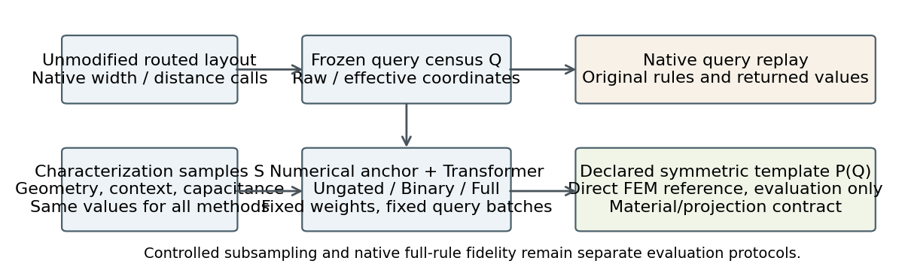
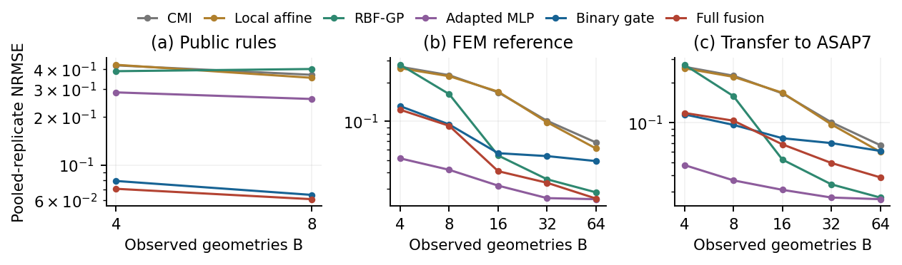
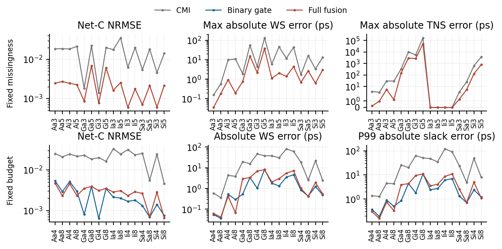
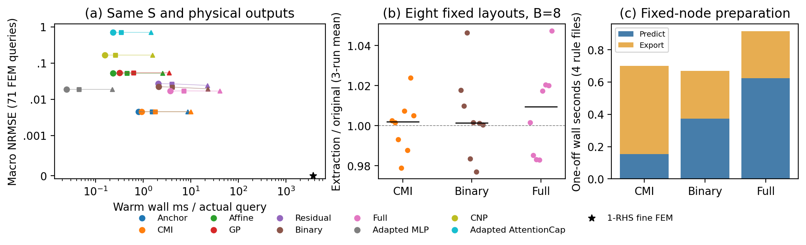

<!-- GENERATED by sync_markdown.py; edit main.tex, not this reading copy. -->

# Characterization-Conditioned Capacitance Estimation for Rule-Based Parasitic Extraction

## Abstract

Rule-based parasitic extraction relies on capacitance tables characterized over interconnect geometries. We present characterization-conditioned estimation combining a numerical anchor, Transformer-predicted residuals, and component-wise gating. Available capacitance observations and material context condition predictions with fixed model parameters. Experiments cover controlled characterization subsampling, finite-element references, cross-process prediction, and native extraction. Full fusion improves over binary gating across all five finite-element conditions at 30% characterization holdout. It improves capacitance and worst-slack fidelity over multilinear interpolation in all sixteen layout–budget settings. A native census records 9.89 million calls. On 71 layout-parameterized off-grid templates with full support, numerical interpolation outperforms the learned corrections, identifying a limit to gains from controlled subsampling.

## Introduction

Rule-based parasitic extraction separates process characterization from layout
 evaluation. Reference capacitances for representative interconnect geometries
are encoded in empirical models or lookup tables, and layout extraction evaluates
the corresponding models for encountered structures [1, 2].
OpenRCX provides a concrete example: its extraction rules are calibrated from
reference parasitics and are evaluated using coupling distance and surrounding
routing context [3, 4].

A finite set of characterization points does not coincide with every geometric
configuration encountered in a routed layout. Between sampled points, the
extractor must estimate capacitance using the available rule data. Model-library
accuracy therefore depends not only on pattern coverage but also on how the
nonlinear geometry–capacitance response is represented between characterization
points [5]. Increasing characterization density can improve
that representation, but also increases the amount of reference data that must
be generated and stored [2]. This motivates improving rule
evaluation while holding the available characterization samples fixed.

Prior work has automated pattern and formula construction from field-solver
samples [6], developed neural capacitance and matrix
predictors [2, 5, 7, 8], and studied geometry and
layer-thickness exploration [1]. We focus on the complementary
problem of estimating uncharacterized queries from a supplied set of
process-specific characterization samples.

We condition a numerical anchor and Transformer residual on supplied capacitance samples, geometry, and material context. Component-wise fusion combines numerical and neural corrections; a binary variant retains the same conditioning interface. Parameters remain fixed during conditional inference, while observations alter predictions. Predicted rule values can be exported into the native flow.

We evaluate controlled characterization subsampling, support-size sensitivity,
cross-process prediction, and native extraction fidelity. Full improves over
Binary in all five FEM conditions at 30% holdout, whereas sparse-support
comparisons and downstream tails often favor simpler methods. A native query
census and direct reference solves on declared layout-parameterized templates
then test relevance and accuracy when all supplied samples remain available.
These evaluations separate native agreement from physical error and distinguish query computation, rule preparation, and native extraction cost.

Our contributions are:

-  Characterization-conditioned estimation using shared target samples and structural/material context, preserving characterized entries and exporting native rules.

-  A shared residual predictor with binary and numerical–neural gates, evaluated through matched controls.

-  Evaluation across characterization coverage, support sizes, and processes, connected to native extraction and timing fidelity.

Figure 1. Characterization-conditioned evaluation. Native query replay measures agreement with the unchanged rule evaluator. Direct FEM evaluates a separately declared layout-parameterized template, with matched support and query physics. Reference labels enter scoring only. These two references are not interchangeable.

## Problem and Related Work
### Pre-characterized rule evaluation
For a fixed process, corner, pattern family, and context $c$, let
$S=\{(x_i,y_i)\}$ be the available characterization samples and let $Q$
contain query geometries. Only the values in $S$ enter prediction:

$$

\widehat y_Q=F_\theta(S,Q,c),\qquad \widehat y(x_i)=y_i\quad(x_i\in S).

$$

An on-grid query coincides with a characterization node. An off-grid query
is in-support if it lies in the valid support hull, and out-of-support if
it lies outside that hull while retaining compatible geometry and output
semantics. Rank-deficient supports require membership in their affine
space; coordinate-wise bounds alone are insufficient. Unsupported material,
conductor topology, or component definitions are coverage exclusions.

Controlled characterization subsampling reserves reference nodes as queries;
a 30% holdout supplies the remaining 70% to every predictor. This protocol
measures support coverage sensitivity and does not measure the distribution
of runtime queries. Inference uses the union of support and query coordinates,
including query–query attention, so predictions are batch-conditioned.
The same conditioning interface applies to a new process with fixed $\theta$.

### Relation to capacitance surrogates and conditional regression
AttentionCap maps conductor geometry to capacitance matrices with a Transformer and symmetric output [7]. Flash-CNNCap maps three-dimensional windows to spatial capacitance contributions in a DEF-to-SPEF flow [8]. Tsai et al. encode geometry and layer thickness for regression and interconnect exploration [1]. Our predictor conditions on observed capacitances to complete rule tables. We compare a component-supervised AttentionCap adaptation and a paper-inspired MLP under this interface; Flash-CNNCap's window representation is compared at the workflow level.

ResCap corrects physical initial estimates for standard-cell capacitance [9]; hybrid PEX selects rule, neural, or field-solver extraction for windows [10]. Our anchor instead uses current support observations, with fusion inside each rule table. CNPs learn context-conditioned regression [11], and attentive neural processes associate queries with context points [12]. Our CNP control tests mean-context regression; the proposed representation adds numerical anchoring and native rule export.

## Characterization-Conditioned Estimator

### Support-derived anchor and representation
The anchor $b_i(S,y_S)$ gives a stable estimate before learned correction. For rank-one support, it uses piecewise-linear interpolation with boundary clamping. For higher-rank support, it uses simplex interpolation inside the support hull and nearest-observation fallback outside it or for degenerate support. This support-derived anchor is distinct from the rank-matched multilinear baseline used in our comparisons.

Geometry tokens encode scaled coordinates, context, an observation indicator, available capacitance, and the anchor. The indicator distinguishes an unobserved zero placeholder from an observed zero. Context includes geometry family, layer indices, and available material descriptors; material tokens encode region bounds and permittivity. Coordinate and target scales are source-fitted and fixed at evaluation.

Binding positions to values distinguishes tables with similar geometry but different responses. The shared Transformer associates queries with relevant support and processes the full grid, including query–query interactions. Attention models relationships between observations and queries; its value relative to simpler regression is tested by the matched and conditional controls.

### Residual correction and component-wise fusion
Let $h_i$ be the shared encoded representation and $\Delta^{\mathrm{NN}}_{i,k}$ its learned residual for component $k$. The final prediction is

$$

\widehat y_{i,k}=\left[b_{i,k}+\sum_{e\in\mathcal E_i}\pi_{i,e,k}\Delta_{i,e,k}\right]_+,\quad i\in Q,

$$

where $[z]_+=\max(z,0)$ and $\pi$ is normalized over applicable correction branches. The gate reads $h_i$ and support descriptors such as observation density, nearest-support distance, local span, and inside-support status. Its weights are component-specific, allowing ground and coupling responses to use different corrections at the same geometry.

*Binary gate* combines zero correction with the raw neural residual. It therefore learns how far to move away from the support anchor. The *Ungated residual* control adds the raw neural residual directly. *Full fusion* augments the same interface with PCHIP where rank-one support permits it, aligned-width interpolation where applicable, six RBF-GP configurations, and a locally clamped reading of the neural residual. Each numerical branch contributes its prediction minus the anchor. The clamped neural reading restricts the completed value to the local support envelope inside support and retains the raw residual outside. The gate also receives component-wise correction disagreement descriptors. All applicable branches are evaluated before fusion; the gate combines outputs rather than skipping branch computation.

GP length multipliers are $\{0.5,1,2\}$ times median nonzero support distance,
with regularization $\{10^{-6},10^{-4}\}$. Unsupported branches are masked.

### Source training and rule export
The encoder has two layers, four attention heads, and width 64; the gate hidden width is 32. Training samples tables and support masks with balanced geometry families and processes. Random, block, boundary, and eligible whole-width masks expose different support structures; holdout ratios are 10/30/50/70%. A source-scaled Huber objective supervises withheld query components. Full, Binary, and Ungated use matched source pools, residual initialization, samplers, optimizer settings, update counts, and three training seeds. AdamW uses learning rate $2\!\times\!10^{-4}$ and weight decay $10^{-4}$. Table I lists update counts; completion predictions average three members.

We restore $y_S$ exactly and write query predictions to their original capacitance fields, preserving other fields including resistance. OpenRCX consumes the completed rules on the fixed routed database; STA uses identical libraries and constraints. Learning thus enters offline rule construction while retaining native layout processing.

## Experimental Setup
### Data and evaluation populations

Table I. Data and source-training opportunities. Counts are fitting/selection/confirmation tables. Public inventory size is 1,713; k denotes 1,000 updates. Matched = Full/Binary/Ungated joint training.

|  | Public | FEM | Transfer |
| — | — | — | — |
| Geometry rank | 1 | 2 | 2 |
| Components | coupling, ground | lateral, ground, diagonal | lateral, ground, diagonal |
| Units | native/length | F/m | F/m |
| Fit/select/confirm | 1051/246/340 | 16/24/16 | 8/12/8 |
| Fit/confirm nodes | variable | 153/128 | 153/128 |
| Budgeted tables | 338 | 16 | 8 |
| Matched updates | 24k | 12k | 12k |
| MLP/CNP updates | 3k | 3k | 3k |
| Adapted AC updates | – | 3k | 3k |

Table I distinguishes the public rule library from FEM references for two-dimensional cross sections with width and spacing variation. FEM covers FreePDK15 and ASAP7; cross-process prediction trains and selects on FreePDK15 and evaluates on ASAP7. Target observations are inputs but target queries are excluded from training and selection. The public confirmation view and native holdout are separately defined evaluation populations. All 84 native holdout tables are excluded from public fitting and selection.

*Controlled characterization subsampling* evaluates 30% random, block, and boundary masks, partitioning queries into inside- and outside-support conditions. We retain the original method-specific mask sequences and score aggregation. *Characterization-support-size sensitivity* seal a common evaluation subset of approximately 20% of each table, then reveal geometries in farthest-first coverage order. Three data seeds (11, 29, 47) define paired populations across methods and budgets. The initial four observations count toward $B$. Public tables support $B=4,8$; FEM and transfer support $B=4,8,16,32,64$. Each geometry query returns all output components. Short tables use a separate feasible two-observation protocol and are excluded from the main budget curves.

### Comparators and training opportunities
Numerical controls include Anchor, rank-matched multilinear interpolation (CMI), piecewise-linear interpolation, PCHIP, inverse-distance weighting, RBF-GP, and local affine fitting. CMI is an explicit multilinear control. Controlled-subsampling GP uses its specified median-distance kernel; budgeted GP selects from the six configurations on source validation. Affine neighborhoods are validation-selected: four public or eight FEM points.

The budgeted learning controls comprise a geometry/context MLP, a mean-context CNP, and adapted AttentionCap. MLP/CNP select their source learning rate from $10^{-3}$ and $3\!\times\!10^{-4}$ on source validation. The MLP then takes 200 target fitting steps using only $S$, selected from 0/50/200; CNP conditions on $S$ without parameter updates. Adapted AttentionCap retains the official Transformer/symmetric matrix head [13], converts recorded conductor rectangles and materials to tokens with an external-boundary token, and supervises only the same three FEM components. Its 50 target fitting steps are source-validation-selected from the same candidates. There is no public-rule AttentionCap result because the required matrix geometry representation is not defined for those inputs. Equal target observations therefore do not imply equal source-training compute; the matched architectural comparison is Full/Binary/Ungated.

Table II. Controlled characterization subsampling at 30%: mean-mask macro NRMSE (lower is better). In/Out denote geometric support; Boundary is the boundary-extrapolation mask. All 15 conditions are shown. Full, Binary, and Ungated average three matched members' predictions. Bold is best among displayed methods. The controlled-subsampling GP uses its specified kernel; the budget-selected GP in Fig. 2 is a separate comparison.

| Data | Queries | CMI | Anchor | Affine | RBF-GP | Ungated | Binary | Full |
| — | — | — | — | — | — | — | — | — |
| Public | In/random | 0.1286 | 0.1286 | 0.2062 | 0.4011 | 0.0875 | 0.0850 | **0.0803** |
| Public | In/block | 0.2812 | 0.2812 | 0.4324 | 0.2490 | **0.0645** | 0.0701 | 0.0678 |
| Public | Out/random | 0.5531 | 0.5531 | 0.4766 | 0.9120 | 0.0965 | 0.0954 | **0.0910** |
| Public | Out/block | 0.9546 | 0.9546 | 0.5588 | 3.5596 | 0.1455 | 0.1420 | **0.1391** |
| Public | Boundary | 1.1867 | 1.1867 | 0.6503 | 4.6800 | 0.1675 | 0.1629 | **0.1620** |
| FEM | In/random | 0.0495 | 0.0208 | 0.0389 | 0.0116 | 0.0529 | 0.0387 | **0.0103** |
| FEM | In/block | 0.1502 | 0.1286 | 0.1579 | 2.8414 | 0.0885 | 0.0560 | **0.0366** |
| FEM | Out/random | 0.1344 | **0.0606** | 0.0621 | 1.0237 | 0.1336 | 0.1303 | 0.0895 |
| FEM | Out/block | 0.9790 | 0.6542 | 0.3374 | 18.3431 | 0.1867 | 0.1479 | **0.1203** |
| FEM | Boundary | 0.6404 | 0.5663 | 0.2376 | 17.6758 | 0.1761 | 0.1388 | **0.1137** |
| Transfer | In/random | 0.0488 | 0.0205 | 0.0381 | **0.0113** | 0.0588 | 0.0432 | 0.0159 |
| Transfer | In/block | 0.1473 | 0.1246 | 0.1542 | 2.5309 | 0.0868 | 0.0640 | **0.0531** |
| Transfer | Out/random | 0.1330 | 0.0595 | **0.0594** | 0.8194 | 0.1172 | 0.1124 | 0.0877 |
| Transfer | Out/block | 0.9583 | 0.6374 | 0.3288 | 16.0145 | 0.1482 | **0.1291** | 0.1358 |
| Transfer | Boundary | 0.6297 | 0.5580 | 0.2364 | 15.5718 | 0.1172 | **0.1037** | 0.1073 |

### Metrics and native reference
For a component group $g$, the common error quantity is

$$

E_g=\sqrt{\frac{\sum_{i\in Q_g}(\widehat y_i-y_i)^2}{\sum_{i\in Q_g}y_i^2}}.

$$

Zero-truth-energy groups are excluded from normalized error and retained for absolute-error reporting. Controlled-subsampling *mean-mask macro NRMSE* pools squared errors within each process/family/component and mask, takes the macro mean, then averages masks. Fixed-budget *pooled-replicate macro NRMSE* pools data seeds before the ratio and square root, then takes the group macro. The support-protocol analysis instead uses *mean-member, group-balanced NRMSE*: component means within tables, averaging data seeds and tables within process/layer groups, then groups and budgets equally, before averaging member scores. It does not average member predictions first.

Native evaluation uses AES and Ibex on ASAP7, GF180, IHP SG13G2, and Sky130HS: eight fixed layouts. The reference is full-rule extraction on the same routed database, libraries, constraints, and tools. Controlled-subsampling exports use block masks at 30/50%; net-C NRMSE is averaged over three seeds, while WS/TNS report the maximum absolute deviation over those seeds. Fixed-budget exports use $B=4,8$ and three data seeds, replacing 83 eligible held-out tables in otherwise complete libraries. One two-node ASAP7 OVER table retains complete values under the common feasibility rule. Fixed-budget metrics average seeds within each layout–budget condition. P99 is the within-run 99th percentile of absolute finite-endpoint slack errors, subsequently seed-averaged. All timing errors are relative to the full-rule reference.

Figure 2. Fixed-observation-budget completion: pooled-replicate macro NRMSE on common sealed queries, with three data seeds and three-member learned ensembles. All displayed methods use the same $B$ target geometries. MLP fits to those observations; Full/Binary keep learned parameters fixed. Only feasible budgets are plotted. CNP, Ungated, and adapted AttentionCap are reported in Table III.

## Results
### Controlled characterization subsampling

Full fusion improves over CMI in all 15 conditions and Binary in 13 (Table II). Across all five FEM conditions, its numerical corrections add value: NRMSE falls from 0.0387 to 0.0103 for in-support random queries and from 0.0560 to 0.0366 for blocks. Relative reductions range from 18.1–73.3%, supporting the correction bank under these coverage patterns.

Public architecture gaps are smaller. Full reaches 0.0803/0.0678 on in-support random/block queries versus Binary's 0.0850/0.0701; Ungated is better on blocks (0.0645). Full reduces out-of-support block and boundary errors to 0.1391 and 0.1620. Cross-table residual learning helps substantially over multilinear completion even where gate complexity has modest benefit.

Cross-process prediction with fixed learned parameters achieves 0.0159 for in-support random queries, compared with Binary's 0.0432. Full also improves over Binary on in-support blocks and out-of-support random queries; Binary is better on out-of-support blocks and the boundary condition. Local affine fitting is a strong numerical counterexample: it obtains 0.0621 versus Full's 0.0895 on FEM out-of-support random queries and 0.0594 versus 0.0877 on transfer. The support anchor is also competitive there. Geometry outside the observed hull therefore does not by itself identify a setting requiring learned fusion.

Figure 3. Native fidelity for every layout and condition. A/G/I/S: ASAP7/GF180/IHP/Sky130HS; a/i: AES/Ibex. Top: 30/50% block holdout (suffix 3/5); net-C is seed-mean NRMSE, WS/TNS are maximum absolute deviations over three seeds. Bottom: budgets 4/8; all values are three-seed means. P99 is absolute endpoint-slack error within each run. Timing units are ps; the top-right TNS axis uses a symmetric-log scale to retain exact zeros. Lines connect conditions for readability, not a geometry sweep. The two rows have different aggregation and are compared only within their own protocol.

### Fixed-observation-budget comparison

Figure 2 separates observation count from the holdout patterns above. On public rules, Full obtains 0.0708 at $B=4$ and 0.0609 at $B=8$, compared with Binary's 0.0793/0.0648 and adapted MLP's 0.2860/0.2599. The conditional residual representation performs well using sparse table-specific observations without target parameter updates.

FEM yields a different comparison. At $B=4$, adapted MLP obtains 0.0515 versus Full's 0.1233 and Binary's 0.1315. At $B=64$, Full (0.0250), selected GP (0.0280), and adapted MLP (0.0248) are close. In transfer at $B=64$, GP and adapted MLP reach 0.0271 and 0.0264, respectively, compared with Full's 0.0386. The availability of a reusable source-trained representation thus does not eliminate the benefit of fitting a simple predictor to target observations.

Table III. Additional fixed-budget controls, pooled-replicate macro NRMSE. AC denotes component-supervised adapted AttentionCap. Dashes mark unavailable or infeasible evaluations. These AC results evaluate the stated rule-completion adaptation, rather than rank the original capacitance-matrix task.

| Data | Method | 4 | 8 | 16 | 32 | 64 |
| — | — | — | — | — | — | — |
| Public | Ungated | 0.0776 | 0.0682 | – | – | – |
| Public | CNP | 0.2650 | 0.2374 | – | – | – |
| Public | Adapted AC | – | – | – | – | – |
| FEM | Ungated | 0.1100 | 0.0917 | 0.0681 | 0.0657 | 0.0609 |
| FEM | CNP | 0.2356 | 0.2313 | 0.2297 | 0.2274 | 0.2271 |
| FEM | Adapted AC | 0.4546 | 0.2256 | 0.2025 | 0.1677 | 0.1657 |
| Transfer | Ungated | 0.1410 | 0.1282 | 0.1069 | 0.0954 | 0.0814 |
| Transfer | CNP | 0.2138 | 0.2126 | 0.2135 | 0.2127 | 0.2136 |
| Transfer | Adapted AC | 6.8753 | 0.3199 | 0.2120 | 0.2153 | 0.1791 |

Table III retains CNP and adapted AttentionCap. CNP is less accurate than Full/Binary in these cohorts. Adapted AttentionCap improves from 0.4546 at FEM $B=4$ to 0.1657 at $B=64$, but reaches 6.8753 at transfer $B=4$, showing sensitivity to sparse component-supervised fitting. In a separate reverse-direction MLP experiment (ASAP7 to FreePDK15), target fitting reduces NRMSE from 0.4414 without updates to 0.0569 at $B=4$ and 0.0284 at $B=64$.

Target fitting consumes updates per table; Full/Binary reuse weights. Full evaluates a numerical bank in addition to its learned correction; full-ensemble costs are measured separately below. FEM characterization work replays recorded costs including initial support; public accesses are simulated. Several strong methods meet the evaluated source-validation tolerances at the first tested $B=4$. These minimum-budget results are retrospective comparisons, not deployment stopping rules with access to query truth.

### Native extraction and timing fidelity

Figure 3 connects table completion to downstream electrical quantities. Under controlled subsampling, Full improves net-C fidelity and reduces worst-slack absolute error relative to multilinear completion in all 16 layout–holdout conditions. For GF180 Ibex at 50% holdout, net-C NRMSE is 0.0061 versus 0.0199, while maximum absolute worst-slack error is 37.01 versus 132.8 ps. The maximum absolute TNS deviation decreases from 168.6 to 50.22 ns. Zero TNS deviations on IHP coexist with changes in positive worst slack, motivating the separate timing columns.

Under fixed observation budgets, Full improves net-C and worst-slack fidelity over CMI in all 16 layout–budget conditions. Relative to Binary, its net-C error improves in six conditions and its worst-slack error improves in four. Binary has lower P99 absolute endpoint-slack error in ten conditions. The largest Full-minus-Binary P99 difference is $+7.6433$ ps for GF180 Ibex at $B=4$, an increase in prediction error relative to the complete-rule reference.

Full versus Binary improves/ties/worsens absolute TNS error in 5/4/7
conditions, ties false negatives in all 16, and ties/worsens false positives
in 14/2. Against CMI, TNS counts are 13/3/0 and false-positive counts 4/9/3.
These dependent fixed-design comparisons measure full-rule fidelity.

### Support-protocol sensitivity
Matched 2,000-step continuation compares original-support (H) and low-budget
coverage sampling (L) for Full/Binary across four process/layer groups and three seeds; count and coverage change jointly. The H-minus-L mean
error improvement is 0.005066 for Full and 0.015766 for Binary. Binary-L wins
at $B=4$ for all seeds and at $B=8$ for two; Full-L wins at $B=16,32$ but is
20.0%/28.9% less accurate than source-trained Full. Original-support retention
error increases from 0.04359 to 0.05209 for Full-L. Thus sparse-support
continuation narrows Full's average advantage over Binary from 0.014088 to
0.002939, with a denser-support accuracy cost. These are mean-member, group-balanced scores; the expanded treatment retains the detailed analysis.

### Native queries and independent template references
Two instrumented OpenROAD `0b54bb3203` capacitance getters (finite width/distance and indexed fringe) preserve SPEF electrical records on all eight fixed routed databases. Of 9,888,586 logged calls and 19,562 unique rule/geometry keys, 2,696,515 hit characterization nodes, 4,547,424 are non-node queries inside the selected width slice, 967,755 lie outside, and 1,676,892 are fringe/special. Non-node calls are 55.77% of logged calls and 67.16% of finite-distance calls. The trace excludes resistance, five-argument diagonal getters, and later assembly.

Figure 4. Accuracy and deployment cost. (a) Same 71 templates; circles/squares/triangles denote Q limits 32/8/1, each with its own error. Y is linear below 0.001 and logarithmic above; the fine-FEM point measures agreement with the fine reference, not zero discretization error. (b) Three-run mean per-layout extraction ratios; bars mark medians. (c) Fixed-node B=8, seed-11 prediction/export for four libraries. Shared setup and adaptation are separate. Panels (b,c) use controlled support; panel (a) uses all S.

Native width mapping and the distance compute grid quantize 849,663 raw non-node calls to characterization nodes. A finite, non-sentinel reimplementation matches 29,735 design-specific records (8,211,694 occurrences), with maximum support-scaled difference $2.1\times10^{-16}$. Rule identity is uniquely resolved for 95.42% of calls; this interface agreement does not establish electrostatic material alignment.

Table IV. Off-grid query comparisons, macro NRMSE. Native agreement: 480 queries from 42 source-held-out rule groups, using every supplied rule sample and actual OpenRCX returns as reference. FEM: 71 independent template queries with 153 matched support samples per context. FEM$_w$ weights occurrences by inverse sampling probability. The last column is warm FEM wall ms/query on one CPU thread, with Q limit 32 and three learned members; fitting/loading is separate. AC is adapted AttentionCap. Native agreement and physical error have distinct references; compare within a column.

| Method | Native | FEM | FEM$_w$ | ms/Q |
| — | — | — | — | — |
| Multilinear | 0.00761 | 0.00452 | 0.00527 | 0.923 |
| Support anchor | 0.00761 | 0.00451 | 0.00527 | 0.788 |
| Local affine | 0.17500 | 0.05254 | 0.05915 | 0.232 |
| RBF-GP | 0.41736 | 0.05371 | 0.04158 | 0.316 |
| Ungated | 0.21853 | 0.02688 | 0.02309 | 2.051 |
| Binary | 0.24363 | 0.02218 | 0.02323 | 2.110 |
| Full | 0.23620 | 0.01675 | 0.01456 | 3.706 |
| Adapted MLP | 0.34070 | 0.01889 | 0.01792 | 0.025 |
| CNP | 0.24988 | 0.16575 | 0.17161 | 0.155 |
| Adapted AC | – | 0.70695 | 0.74013 | 0.230 |

For direct references, 114 ASAP7 AES/Ibex candidates on M4/M5 in adjacent
OVER, UNDER, and OVERUNDER contexts account for 86,587 calls (0.876%).
Geometry-only stratification fixes 12 pilot and 71 formal queries before
solving. Widths are 0.024/0.032 $\mu$m; queries differ from original CTF nodes
at database resolution. All 153 samples per context remain available.

The physical cohort is a *layout-parameterized template*: logged width
and spacing drive symmetric, equal-width side wires, finite adjacent grounded
planes, and an exterior grounded boundary in the declared ASAP7 CTF stack.
It does not retain arbitrary asymmetric routing, net connections, or a full
layout section. Ground and summed lateral coupling are projected from the
Maxwell matrix in F/m. Original native calibration materials and projections
are not jointly aligned with this template, so no native-versus-FEM physical
accuracy claim is made. For the same template, direct P2 FEM solves provide
query labels independently of prediction; support geometry, solver hashes,
and component projections are verified against the reused matrices.

All 83 pilot/formal geometries pass coarse/fine/doubled-domain and component-scaled convergence checks; twelve on-grid controls reproduce the reused matrices exactly. Macro normalized uncertainty is 0.00016, versus Anchor/Full/Binary errors of 0.00451/0.01675/0.02218. Training and selection use FreePDK15 only. With all supplied samples, Full improves over Binary and adapted MLP but not numerical interpolation (Table IV). Interpolation also agrees more closely with native returns; agreement alone does not rank physical accuracy.

Canonical batches include all S and at most 32 hash-sorted queries per context. The query API preserves original-grid predictions and observed values exactly. Changing Q affects Full (public maximum 0.0205 in source-normalized units), whereas canonical input reordering does not. Raw FEM token reordering changes Full by 0.00319 through order-sensitive support envelopes.

### Accuracy–Runtime Trade-offs and Deployment Cost
On one pinned Xeon Gold 6530 thread, three warmups precede 20 randomized
timing blocks. Each Q limit (1/8/32) has its own scored predictions.
Warm times include encoding, numerical candidates, three learned members and
assembly; only requested geometries enter the denominator.
At Q limit 32, Full/Binary/Anchor cost
3.706/2.110/0.788 ms/query
(Table IV, Fig. 4).
Full's measured single-request mean is 40.97 ms.

With support fits retained, adapted MLP costs 0.025 ms/query
at NRMSE 0.01889; its six-context fit costs
14.03 s including first-use optimizer initialization.
Adapted AttentionCap costs 0.230 ms/query, but its NRMSE is
0.70695, with 11.27 s adaptation.
Neither fit accesses query labels. Query-dependent Transformer support states
are not cached. Anchor/CMI are more accurate than Full here.

Resident one-RHS fine P2 solving costs 3.719 s/query,
including remeshing, assembly, factorization and both nonzero outputs.
All 213 solves match certified full-matrix target rows within
$1.5\times10^{-15}$ relative scale. Certification cost is separate;
surrogate errors exceed reference uncertainty, precluding an equal-accuracy
speedup claim. A validated C++ finite-distance getter counterpart costs
1.72 ns/query in warm loops after width/context resolution
(0.567 $\mu$s through ctypes), not a complete PEX query.

Across 96 release runs, Full's extraction/original ratio is
0.983–1.047. Fixed-node prediction/export for four libraries
at B=8, seed 11 costs 0.70/0.67/0.91 s
for CMI/Binary/Full, plus 0.88 s shared loading/support preparation.
Each library serves two measured layouts. SPEF writing and STA are separate;
rule parsing remains in extraction. Electrical results match the frozen
variants exactly. This offline configuration keeps learned inference outside
the native extraction loop.

## Conclusion
Characterization-conditioned residual prediction links rule completion to PEX/STA fidelity. Its benefit depends on support coverage: Full improves tested subsampling conditions, while interpolation is more accurate on the fully supported off-grid templates. Measured preparation and query costs motivate explicit deployment choices. Evidence covers query replay and fixed-node export; node enrichment and online substitution remain unestablished.

## References

[1] C.-Y. Tsai, S. Kim, and S.-K. Lim, ``Capacitance extraction via machine learning with application to interconnect geometry exploration,'' in *Proc. IEEE/ACM Int. Conf. Computer-Aided Design (ICCAD)*, 2025.

[2] D. Yang, H. Li, W. Yu, Y. Guo, and W. Liang, ``CNN-Cap: Effective convolutional neural network-based capacitance models for interconnect capacitance extraction,'' *ACM Transactions on Design Automation of Electronic Systems*, vol. 28, no. 4, 2023. [Online]. Available: https://numbda.cs.tsinghua.edu.cn/papers/todaes232.pdf

[3] The OpenROAD Project, ``Parasitics extraction,'' OpenROAD documentation, accessed: 2026-11-14. [Online]. Available: https://openroad.readthedocs.io/en/latest/main/src/rcx/README.html

[4] OpenROAD Project, ``OpenRCX: Extraction rules file generation,'' OpenROAD documentation, accessed Nov. 14, 2026. [Online]. Available: https://openroad.readthedocs.io/en/latest/main/src/rcx/doc/calibration.html

[5] X. Zhou, J. Zhang, B. Li, W. Liu, Z. Wu, and B. Lu, ``RMLP-Cap: An end-to-end parasitic capacitance extraction flow based on ResMLP,'' *Electronics*, vol. 15, no. 1, p. 36, 2026. [Online]. Available: https://www.mdpi.com/2079-9292/15/1/36

[6] Z. Li and W. Shi, ``Layout capacitance extraction using automatic pre-characterization and machine learning,'' in *21st International Symposium on Quality Electronic Design (ISQED)*, 2020, pp. 457–464. [Online]. Available: https://ieeexplore.ieee.org/document/9136970/

[7] J. Huang, H. R. Rodriguez, D. Yang, Z. Ye, Y. Lin, and W. Yu, ``AttentionCap: Transformer based capacitance matrix learning toward full-chip extraction,'' in *Proc. ACM/IEEE Design Automation Conf. (DAC)*, 2026, arXiv:2606.08161. [Online]. Available: https://arxiv.org/abs/2606.08161

[8] H. R. Rodriguez, J. Huang, and W. Yu, ``Flash-CNNCap: Capacitance extraction via image mapping,'' in *Proc. IEEE/ACM Int. Conf. Computer-Aided Design (ICCAD)*, 2026, arXiv:2607.23877. [Online]. Available: https://arxiv.org/abs/2607.23877

[9] J.-C. Tsai, H.-M. Huang, W.-M. Hsu, P.-T. Lee, J.-H. Yang, H.-L. Huang, Y.-J. Su, and C. H.-P. Wen, ``ResCap: Fast-yet-accurate capacitance extraction for standard cell design by physics-guided machine learning,'' in *Proc. Asia and South Pacific Design Automation Conf. (ASP-DAC)*, 2025, pp. 1243–1250.

[10] M. S. Abouelyazid, S. Hammouda, and Y. Ismail, ``Accuracy-based hybrid parasitic capacitance extraction using rule-based, neural-networks, and field-solver methods,'' *IEEE Trans. Computer-Aided Design Integr. Circuits Syst.*, vol. 41, no. 12, pp. 5681–5694, 2022.

[11] M. Garnelo, D. Rosenbaum, C. Maddison, T. Ramalho, D. Saxton, M. Shanahan, Y. W. Teh, D. Rezende, and S. M. A. Eslami, ``Conditional neural processes,'' in *Proc. Int. Conf. Machine Learning (ICML)*, ser. PMLR, vol. 80, 2018, pp. 1704–1713. [Online]. Available: https://proceedings.mlr.press/v80/garnelo18a.html

[12] H. Kim, A. Mnih, J. Schwarz, M. Garnelo, A. Eslami, D. Rosenbaum, O. Vinyals, and Y. W. Teh, ``Attentive neural processes,'' in *Proc. Int. Conf. Learning Representations (ICLR)*, 2019. [Online]. Available: https://arxiv.org/abs/1901.05761

[13] AttentionCap Authors, ``AttentionCap: Official implementation,'' 2026, transformer and symmetric output implementation. [Online]. Available: https://github.com/THU-numbda/AttentionCap
