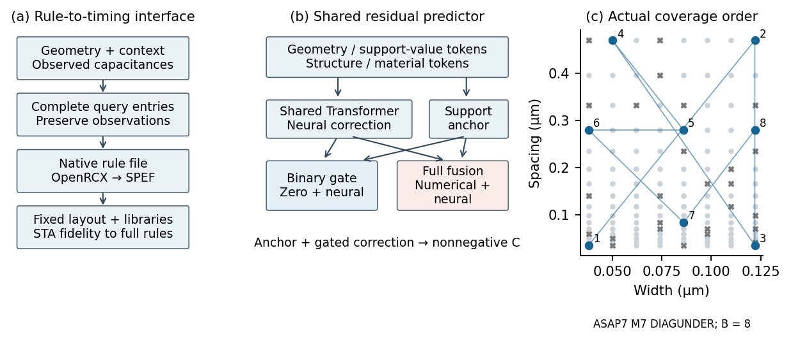
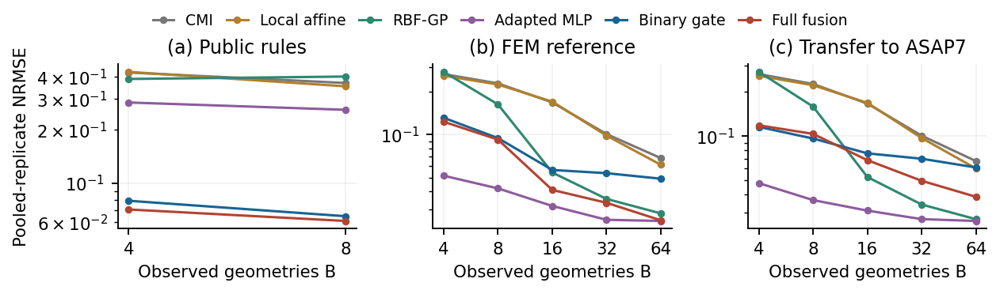
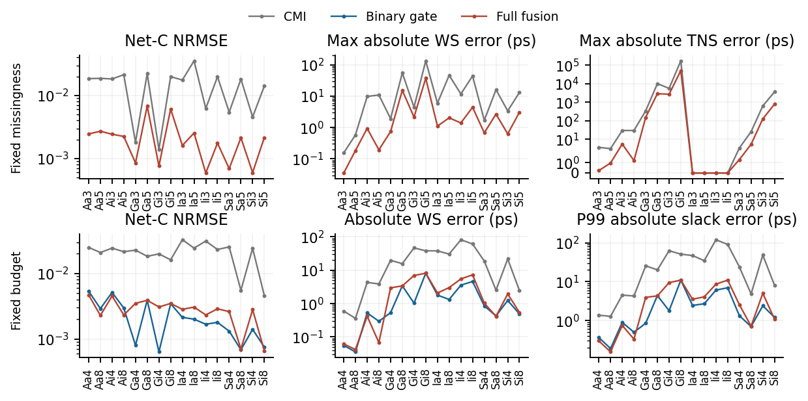
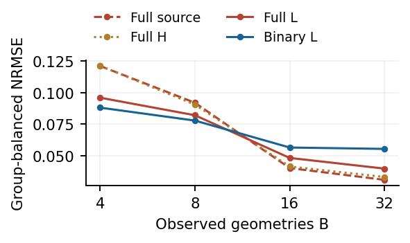

<!-- GENERATED by sync_markdown.py; edit main.tex, not this reading copy. -->

# Observation-Conditioned Capacitance Rule Completion for Parasitic Extraction

## Abstract

Rule-based parasitic extraction relies on capacitance tables characterized over interconnect geometries. We present observation-conditioned completion combining a numerical anchor, Transformer-predicted residuals, and component-wise gating. Available capacitance observations and material context condition predictions with fixed model parameters. Experiments cover public rules, finite-element references, cross-process prediction, and native extraction. Full fusion improves over binary gating across all five finite-element conditions at 30% missingness. It improves capacitance and worst-slack fidelity over multilinear interpolation in all sixteen layout–budget settings. Fixed-budget comparisons and matched controls characterize accuracy and computation tradeoffs among full fusion, binary gating, and target-adapted prediction under shared target observations.

## Introduction
Parasitic extraction supplies electrical models for static timing analysis (STA). Rule-based extractors query precharacterized capacitance tables as widths, spacings, and neighboring layers vary across a routed design. OpenRCX generates such rules from characterized wire patterns [1]. When a table is partly characterized, its completion rule determines capacitance at remaining geometries. We study how available observations can complete these rules and recover the extraction behavior of the full library.

A target table supplies candidate geometries, structural/material context, and observed geometry–capacitance pairs. These observations reveal its local electrical response and complement information learned from other tables. Conditioning on them updates the completed table while keeping learned parameters fixed, even when the target has too few observations to train a flexible model independently.

Our predictor learns residual corrections to an anchor constructed from the available support. Geometry tokens bind positions to observation indicators, known capacitances, and anchor values; material tokens supply context. A shared Transformer associates queries with the observed response. Component-wise gating then combines corrections in a lightweight *Binary gate* or a richer numerical–neural *Full fusion*. Both preserve characterized entries and export native extraction rules.

Useful model complexity depends on support conditions. Full fusion improves over Binary gate in all five finite-element (FEM) coverage conditions at 30% missingness. At fixed sparse budgets, a target-adapted MLP is more accurate on several FEM and transfer conditions. Full improves native net-capacitance and worst-slack fidelity over multilinear interpolation in all 16 layout–budget conditions, while Binary has lower timing-tail error in ten. We therefore evaluate coverage, observation count, and downstream use together.

Our contributions are:

-  Observation-conditioned rule completion using target observations and structural/material context, preserving characterized entries and exporting native rules.

-  A shared residual predictor with binary and numerical–neural gates, evaluated through matched controls.

-  Evaluation across missingness, observation budgets, and processes, connected to native extraction and timing fidelity.

Figure 1. Completion and deployment. (a) Completed rules enter OpenRCX and STA on a fixed routed design; the complete rule library supplies the evaluation reference. (b) The same representation supports binary gating and numerical–neural fusion. (c) A real 128-node FEM table and its recorded first eight coverage samples (numbered); crosses denote sealed evaluation queries. Coverage sampling spreads observations across geometry, whereas random, block, and boundary masks test different patterns of missing support.

## Problem and Related Work
### Rule completion from available observations
A table contains candidate geometries $X=\{x_i\}_{i=1}^N$, context $c$, and $K$ capacitance components at each geometry. Let $S$ denote observed indices and $Q$ the unobserved indices to be predicted. The completion interface is

$$

\widehat y_Q=F_\theta(X,c,S,y_S),\qquad \widehat y_S=y_S.

$$

Only $y_S$ is visible at prediction time. Coordinates of the entire candidate grid are available, so the task is offline completion of a fixed rule grid. Extrapolation refers to query positions outside the geometric support of $S$, rather than necessarily outside the source training distribution. The same interface applies to a new process: target observations enter the predictor even when $\theta$ remains fixed.

### Relation to capacitance surrogates and conditional regression
AttentionCap maps conductor geometry to capacitance matrices with a Transformer and symmetric output [2]. Flash-CNNCap maps three-dimensional windows to spatial capacitance contributions in a DEF-to-SPEF flow [3]. Tsai et al. encode geometry and layer thickness for regression and interconnect exploration [4]. Our predictor conditions on observed capacitances to complete rule tables. We compare a component-supervised AttentionCap adaptation and a paper-inspired MLP under this interface; Flash-CNNCap's window representation is compared at the workflow level.

ResCap corrects physical initial estimates for standard-cell capacitance [5]; hybrid PEX selects rule, neural, or field-solver extraction for windows [6]. Our anchor instead uses current support observations, with fusion inside each rule table. CNPs learn context-conditioned regression [7], and attentive neural processes associate queries with context points [8]. Our CNP control tests mean-context regression; the proposed representation adds numerical anchoring and native rule export.

## Observation-Conditioned Rule Completion

### Support-derived anchor and representation
The anchor $b_i(S,y_S)$ gives a stable estimate before learned correction. For rank-one support, it uses piecewise-linear interpolation with boundary clamping. For higher-rank support, it uses simplex interpolation inside the support hull and nearest-observation fallback outside it or for degenerate support. This support-derived anchor is distinct from the rank-matched multilinear baseline used in our comparisons.

Geometry tokens encode scaled coordinates, context, an observation indicator, available capacitance, and the anchor. The indicator distinguishes an unobserved zero placeholder from an observed zero. Context includes geometry family, layer indices, and available material descriptors; material tokens encode region bounds and permittivity. Coordinate and target scales are source-fitted and fixed at evaluation.

Binding positions to values distinguishes tables with similar geometry but different responses. The shared Transformer associates queries with relevant support and processes the full grid, including query–query interactions. Attention models relationships between observations and queries; its value relative to simpler regression is tested by the matched and conditional controls.

### Residual correction and component-wise fusion
Let $h_i$ be the shared encoded representation and $\Delta^{\mathrm{NN}}_{i,k}$ its learned residual for component $k$. The final prediction is

$$

\widehat y_{i,k}=\left[b_{i,k}+\sum_{e\in\mathcal E_i}\pi_{i,e,k}\Delta_{i,e,k}\right]_+,\quad i\in Q,

$$

where $[z]_+=\max(z,0)$ and $\pi$ is normalized over applicable correction branches. The gate reads $h_i$ and support descriptors such as observation density, nearest-support distance, local span, and inside-support status. Its weights are component-specific, allowing ground and coupling responses to use different corrections at the same geometry.

*Binary gate* combines zero correction with the raw neural residual. It therefore learns how far to move away from the support anchor. The *Ungated residual* control adds the raw neural residual directly. *Full fusion* augments the same interface with PCHIP where rank-one support permits it, aligned-width interpolation where applicable, six RBF-GP configurations, and a locally clamped reading of the neural residual. Each numerical branch contributes its prediction minus the anchor. The clamped neural reading restricts the completed value to the local support envelope inside support and retains the raw residual outside. The gate also receives component-wise correction disagreement descriptors. All applicable branches are evaluated before fusion; the gate combines outputs rather than skipping branch computation.

PCHIP supplies shape-preserving responses, aligned-width interpolation uses width slices, RBF kernels supply smooth alternatives, and neural corrections transfer cross-table relationships. GP length multipliers are $\{0.5,1,2\}$ times median nonzero support distance, paired with regularization $\{10^{-6},10^{-4}\}$. Unsupported branches are masked before gate normalization.

### Source training and rule export
The encoder has two layers, four attention heads, and width 64; the gate hidden width is 32. Training samples tables and support masks with balanced geometry families and processes. Random, block, boundary, and eligible whole-width masks expose different support structures; missingness ratios are 10/30/50/70%. A source-scaled Huber objective supervises withheld query components. Full, Binary, and Ungated use matched source pools, residual initialization, samplers, optimizer settings, update counts, and three training seeds. AdamW uses learning rate $2\!\times\!10^{-4}$ and weight decay $10^{-4}$. Table I lists update counts; completion predictions average three members.

We restore $y_S$ exactly and write query predictions to their original capacitance fields, preserving other fields including resistance. OpenRCX consumes the completed rules on the fixed routed database; STA uses identical libraries and constraints. Learning thus enters offline rule construction while retaining native layout processing.

## Experimental Setup
### Data and evaluation populations

Table I. Data and source-training opportunities. Counts are fitting/selection/confirmation tables. Public inventory size is 1,713; k denotes 1,000 updates. Matched = Full/Binary/Ungated joint training.

|  | Public | FEM | Transfer |
| — | — | — | — |
| Geometry rank | 1 | 2 | 2 |
| Components | coupling, ground | lateral, ground, diagonal | lateral, ground, diagonal |
| Units | native/length | F/m | F/m |
| Fit/select/confirm | 1051/246/340 | 16/24/16 | 8/12/8 |
| Fit/confirm nodes | variable | 153/128 | 153/128 |
| Budgeted tables | 338 | 16 | 8 |
| Matched updates | 24k | 12k | 12k |
| MLP/CNP updates | 3k | 3k | 3k |
| Adapted AC updates | – | 3k | 3k |

Table I distinguishes the public rule library from FEM references for two-dimensional cross sections with width and spacing variation. FEM covers FreePDK15 and ASAP7; cross-process prediction trains and selects on FreePDK15 and evaluates on ASAP7. Target observations are inputs but target queries are excluded from training and selection. The public confirmation view and native holdout are separately defined evaluation populations. All 84 native holdout tables are excluded from public fitting and selection.

*Fixed missingness* evaluates 30% random, block, and boundary masks, partitioning queries into inside- and outside-support conditions. We retain the original method-specific mask sequences and score aggregation. *Fixed observation budgets* seal a common evaluation subset of approximately 20% of each table, then reveal geometries in farthest-first coverage order. Three data seeds (11, 29, 47) define paired populations across methods and budgets. The initial four observations count toward $B$. Public tables support $B=4,8$; FEM and transfer support $B=4,8,16,32,64$. Each geometry query returns all output components. Short tables use a separate feasible two-observation protocol and are excluded from the main budget curves.

### Comparators and training opportunities
Numerical controls include Anchor, rank-matched commercial-style multilinear interpolation (CMI), OpenRCX-style linear interpolation, PCHIP, inverse-distance weighting, RBF-GP, and local affine fitting. CMI is an explicit multilinear control. Fixed-missingness GP uses its specified median-distance kernel; budgeted GP selects from the six configurations on source validation. Affine neighborhoods are validation-selected: four public or eight FEM points.

The budgeted learning controls comprise a geometry/context MLP, a mean-context CNP, and adapted AttentionCap. MLP/CNP select their source learning rate from $10^{-3}$ and $3\!\times\!10^{-4}$ on source validation. The MLP then takes 200 target fitting steps using only $S$, selected from 0/50/200; CNP conditions on $S$ without parameter updates. Adapted AttentionCap retains the official Transformer/symmetric matrix head [9], converts recorded conductor rectangles and materials to tokens with an external-boundary token, and supervises only the same three FEM components. Its 50 target fitting steps are source-validation-selected from the same candidates. There is no public-rule AttentionCap result because the required matrix geometry representation is not defined for those inputs. Equal target observations therefore do not imply equal source-training compute; the matched architectural comparison is Full/Binary/Ungated.

Table II. Fixed-missingness completion at 30%: mean-mask macro NRMSE (lower is better). In/Out denote geometric support; Boundary is the boundary-extrapolation mask. All 15 conditions are shown. Full, Binary, and Ungated average three matched members' predictions. Bold is best among displayed methods. The fixed-missingness GP uses its specified kernel; the budget-selected GP in Fig. 2 is a separate comparison.

| Data | Queries | CMI | Anchor | Affine | RBF-GP | Ungated | Binary | Full |
| — | — | — | — | — | — | — | — | — |
| Public | In/random | 0.1286 | 0.1286 | 0.2062 | 0.4011 | 0.0875 | 0.0850 | **0.0803** |
| Public | In/block | 0.2812 | 0.2812 | 0.4324 | 0.2490 | **0.0645** | 0.0701 | 0.0678 |
| Public | Out/random | 0.5531 | 0.5531 | 0.4766 | 0.9120 | 0.0965 | 0.0954 | **0.0910** |
| Public | Out/block | 0.9546 | 0.9546 | 0.5588 | 3.5596 | 0.1455 | 0.1420 | **0.1391** |
| Public | Boundary | 1.1867 | 1.1867 | 0.6503 | 4.6800 | 0.1675 | 0.1629 | **0.1620** |
| FEM | In/random | 0.0495 | 0.0208 | 0.0389 | 0.0116 | 0.0529 | 0.0387 | **0.0103** |
| FEM | In/block | 0.1502 | 0.1286 | 0.1579 | 2.8414 | 0.0885 | 0.0560 | **0.0366** |
| FEM | Out/random | 0.1344 | **0.0606** | 0.0621 | 1.0237 | 0.1336 | 0.1303 | 0.0895 |
| FEM | Out/block | 0.9790 | 0.6542 | 0.3374 | 18.3431 | 0.1867 | 0.1479 | **0.1203** |
| FEM | Boundary | 0.6404 | 0.5663 | 0.2376 | 17.6758 | 0.1761 | 0.1388 | **0.1137** |
| Transfer | In/random | 0.0488 | 0.0205 | 0.0381 | **0.0113** | 0.0588 | 0.0432 | 0.0159 |
| Transfer | In/block | 0.1473 | 0.1246 | 0.1542 | 2.5309 | 0.0868 | 0.0640 | **0.0531** |
| Transfer | Out/random | 0.1330 | 0.0595 | **0.0594** | 0.8194 | 0.1172 | 0.1124 | 0.0877 |
| Transfer | Out/block | 0.9583 | 0.6374 | 0.3288 | 16.0145 | 0.1482 | **0.1291** | 0.1358 |
| Transfer | Boundary | 0.6297 | 0.5580 | 0.2364 | 15.5718 | 0.1172 | **0.1037** | 0.1073 |

### Metrics and native reference
For a component group $g$, the common error quantity is

$$

E_g=\sqrt{\frac{\sum_{i\in Q_g}(\widehat y_i-y_i)^2}{\sum_{i\in Q_g}y_i^2}}.

$$

Zero-truth-energy groups are excluded from normalized error and retained for absolute-error reporting. Fixed-missingness *mean-mask macro NRMSE* pools squared errors within each process/family/component and mask, takes the macro mean, then averages masks. Fixed-budget *pooled-replicate macro NRMSE* pools data seeds before the ratio and square root, then takes the group macro. The support-protocol analysis instead uses *mean-member, group-balanced NRMSE*: component means within tables, averaging data seeds and tables within process/layer groups, then groups and budgets equally, before averaging member scores. It does not average member predictions first.

Native evaluation uses AES and Ibex on ASAP7, GF180, IHP SG13G2, and Sky130HS: eight fixed layouts. The reference is full-rule extraction on the same routed database, libraries, constraints, and tools. Fixed-missingness exports use block masks at 30/50%; net-C NRMSE is averaged over three seeds, while WS/TNS report the maximum absolute deviation over those seeds. Fixed-budget exports use $B=4,8$ and three data seeds, replacing 83 eligible held-out tables in otherwise complete libraries. One two-node ASAP7 OVER table retains complete values under the common feasibility rule. Fixed-budget metrics average seeds within each layout–budget condition. P99 is the within-run 99th percentile of absolute finite-endpoint slack errors, subsequently seed-averaged. All timing errors are relative to the full-rule reference.

Figure 2. Fixed-observation-budget completion: pooled-replicate macro NRMSE on common sealed queries, with three data seeds and three-member learned ensembles. All displayed methods use the same $B$ target geometries. MLP fits to those observations; Full/Binary keep learned parameters fixed. Only feasible budgets are plotted. CNP, Ungated, and adapted AttentionCap are reported in Table III.

## Results
### Fixed-missingness completion and matched controls

Full fusion improves over CMI in all 15 conditions and Binary in 13 (Table II). Across all five FEM conditions, its numerical corrections add value: NRMSE falls from 0.0387 to 0.0103 for in-support random queries and from 0.0560 to 0.0366 for blocks. Relative reductions range from 18.1–73.3%, supporting the correction bank under these coverage patterns.

Public architecture gaps are smaller. Full reaches 0.0803/0.0678 on in-support random/block queries versus Binary's 0.0850/0.0701; Ungated is better on blocks (0.0645). Full reduces out-of-support block and boundary errors to 0.1391 and 0.1620. Cross-table residual learning helps substantially over multilinear completion even where gate complexity has modest benefit.

Cross-process prediction with fixed learned parameters achieves 0.0159 for in-support random queries, compared with Binary's 0.0432. Full also improves over Binary on in-support blocks and out-of-support random queries; Binary is better on out-of-support blocks and the boundary condition. Local affine fitting is a strong numerical counterexample: it obtains 0.0621 versus Full's 0.0895 on FEM out-of-support random queries and 0.0594 versus 0.0877 on transfer. The support anchor is also competitive there. Geometry outside the observed hull therefore does not by itself identify a setting requiring learned fusion.

Figure 3. Native fidelity for every layout and condition. A/G/I/S: ASAP7/GF180/IHP/Sky130HS; a/i: AES/Ibex. Top: 30/50% block missingness (suffix 3/5); net-C is seed-mean NRMSE, WS/TNS are maximum absolute deviations over three seeds. Bottom: budgets 4/8; all values are three-seed means. P99 is absolute endpoint-slack error within each run. Timing units are ps; the top-right TNS axis uses a symmetric-log scale to retain exact zeros. Lines connect conditions for readability, not a geometry sweep. The two rows have different aggregation and are compared only within their own protocol.

### Fixed-observation-budget comparison

Figure 2 separates observation count from the missingness patterns above. On public rules, Full obtains 0.0708 at $B=4$ and 0.0609 at $B=8$, compared with Binary's 0.0793/0.0648 and adapted MLP's 0.2860/0.2599. The conditional residual representation performs well using sparse table-specific observations without target parameter updates.

FEM yields a different comparison. At $B=4$, adapted MLP obtains 0.0515 versus Full's 0.1233 and Binary's 0.1315. At $B=64$, Full (0.0250), selected GP (0.0280), and adapted MLP (0.0248) are close. In transfer at $B=64$, GP and adapted MLP reach 0.0271 and 0.0264, respectively, compared with Full's 0.0386. The availability of a reusable source-trained representation thus does not eliminate the benefit of fitting a simple predictor to target observations.

Table III. Additional fixed-budget controls, pooled-replicate macro NRMSE. AC denotes component-supervised adapted AttentionCap. Dashes mark unavailable or infeasible evaluations. These AC results evaluate the stated rule-completion adaptation, rather than rank the original capacitance-matrix task.

| Data | Method | 4 | 8 | 16 | 32 | 64 |
| — | — | — | — | — | — | — |
| Public | Ungated | 0.0776 | 0.0682 | – | – | – |
| Public | CNP | 0.2650 | 0.2374 | – | – | – |
| Public | Adapted AC | – | – | – | – | – |
| FEM | Ungated | 0.1100 | 0.0917 | 0.0681 | 0.0657 | 0.0609 |
| FEM | CNP | 0.2356 | 0.2313 | 0.2297 | 0.2274 | 0.2271 |
| FEM | Adapted AC | 0.4546 | 0.2256 | 0.2025 | 0.1677 | 0.1657 |
| Transfer | Ungated | 0.1410 | 0.1282 | 0.1069 | 0.0954 | 0.0814 |
| Transfer | CNP | 0.2138 | 0.2126 | 0.2135 | 0.2127 | 0.2136 |
| Transfer | Adapted AC | 6.8753 | 0.3199 | 0.2120 | 0.2153 | 0.1791 |

Table III retains CNP and adapted AttentionCap. CNP is less accurate than Full/Binary in these cohorts. Adapted AttentionCap improves from 0.4546 at FEM $B=4$ to 0.1657 at $B=64$, but reaches 6.8753 at transfer $B=4$, showing sensitivity to sparse component-supervised fitting. In a separate reverse-direction MLP experiment (ASAP7 to FreePDK15), target fitting reduces NRMSE from 0.4414 without updates to 0.0569 at $B=4$ and 0.0284 at $B=64$.

Target fitting consumes updates per table; Full/Binary reuse weights. Full still evaluates its numerical bank: recorded shared encoding plus one forward pass costs 15.05–18.01 ms for Full-L versus 8.58–10.75 ms for Binary-L across the support-analysis budgets (single-member component costs, not ensemble wall times). FEM characterization work replays recorded costs including initial support; public accesses are simulated. Several strong methods meet the evaluated source-validation tolerances at the first tested $B=4$, leaving lower necessary characterization budgets unresolved.

### Native extraction and timing fidelity

Figure 3 connects table completion to downstream electrical quantities. Under fixed missingness, Full improves net-C fidelity and reduces worst-slack absolute error relative to multilinear completion in all 16 layout–missingness conditions. For GF180 Ibex at 50% missingness, net-C NRMSE is 0.0061 versus 0.0199, while maximum absolute worst-slack error is 37.01 versus 132.8 ps. The maximum absolute TNS deviation decreases from 168.6 to 50.22 ns. Zero TNS deviations on IHP coexist with changes in positive worst slack, motivating the separate timing columns.

Under fixed observation budgets, Full improves net-C and worst-slack fidelity over CMI in all 16 layout–budget conditions. Relative to Binary, its net-C error improves in six conditions and its worst-slack error improves in four. Binary has lower P99 absolute endpoint-slack error in ten conditions. The largest Full-minus-Binary P99 difference is $+7.6433$ ps for GF180 Ibex at $B=4$, an increase in prediction error relative to the complete-rule reference.

Equal-layout averages also favor Binary over Full at $B=4$: net-C NRMSE is 0.002309 versus 0.003297, absolute worst-slack error is 1.1989 versus 2.6146 ps, and P99 absolute slack error is 2.0092 versus 4.2546 ps. CMI's mean worst-slack error is 29.0093 ps. Gains over multilinear completion propagate to timing, while the extra fusion bank has more selective benefit.

Tail and decision metrics provide a further distinction. Against Binary, Full improves/ties/worsens absolute TNS error in 5/4/7 conditions, ties false negatives in all 16, and ties/worsens false positives in 14/2. Against CMI, TNS counts are 13/3/0, while false positives improve/tie/worsen in 4/9/3. All comparisons use the same completed-table population and fixed designs. Native fidelity is agreement with full-rule extraction; shared libraries and layouts make these conditions dependent, and the sensitivity of a circuit path can amplify errors that appear small at the table level.

### Support-protocol sensitivity and computational tradeoffs

Figure 4. Support-protocol sensitivity: mean-member, group-balanced NRMSE, averaged over three training seeds. Source denotes the source-trained Full; H and L use 2,000 matched continuation steps per member. Binary-L is better at $B=4,8$ on average. Full-L exceeds Binary-L at $B=16,32$ but is less accurate than source-trained Full at those budgets. This metric differs from the ensemble metric in Fig. 2.

The 153-node FEM training tables retain at least 46 observations under 10/30/50/70% missingness; whole-width holdouts also retain more than four. To study the low-budget mismatch, we compare Full/Binary under original support (H) and low-budget support (L), using common source data, three original seeds, paired episodes, and 2,000 continuation steps per endpoint (12 total). L uses coverage sampling at $B=4,8,16,32$, changing support count and coverage jointly.

Figure 4 shows the resulting interaction. The H-minus-L mean error improvement is 0.005066 for Full and 0.015766 for Binary; their difference is $-0.010701$, indicating a larger response for Binary. Full-L retains a four-budget average advantage of 0.002939 over Binary-L, with the same sign for all three seed-level averages. At $B=4$, however, Binary-L wins for all three seeds; at $B=8$, it wins for two. At $B=16,32$, Full-L is better than Binary-L but worse than both source-trained Full and Full-H. Relative to source-trained Full, its mean errors increase by 20.0% and 28.9% at those budgets.

Original-support retention error increases from 0.04359 to 0.05209 for source-trained Full versus Full-L, and from 0.06366 to 0.06808 for Binary. Full's four-budget advantage over Binary narrows from 0.014088 to 0.002939: low-budget continuation primarily closes the gap for the simpler gate, with a denser-support accuracy cost. Across 1,728 paired component/seed/cell outcomes, Full-L's capacitance P99 error is lower/tied/higher than Binary-L in 887/225/616 cases. These correlated rule-level tails are separate from the native STA tails.

### Discussion
Target observations support three deployment choices: numerical fitting, source-trained conditional residuals, and target parameter adaptation. Full fusion adds value in all five FEM fixed-missingness conditions; sparse support and native timing tails favor simpler alternatives in several comparisons. The applicable support protocol is therefore central to choosing predictor complexity.

Public geometry is rank one, FEM models idealized two-dimensional cross sections, and native exports replace held-out tables within otherwise complete libraries. Budgeted learning controls have different source-training opportunities; their fixed-missingness counterparts and native MLP/GP comparisons remain unevaluated. The support analysis covers four process/layer groups and three seeds, changing count and coverage jointly. Deployment selection should consider table accuracy, target fitting, correction-bank computation, and downstream error metrics.

## Conclusion
We presented observation-conditioned capacitance rule completion with an anchor-based residual predictor, binary and numerical–neural gates, and native rule export. Experiments connect completion to extraction and timing fidelity, showing how support coverage, target adaptation, and fusion complexity affect accuracy and cost. The interface combines learned cross-table information with observations already available in a rule library.

## References

[1] OpenROAD Project, ``OpenRCX: Extraction rules file generation,'' OpenROAD documentation, accessed Nov. 14, 2026. [Online]. Available: https://openroad.readthedocs.io/en/latest/main/src/rcx/doc/calibration.html

[2] J. Huang, H. R. Rodriguez, D. Yang, Z. Ye, Y. Lin, and W. Yu, ``AttentionCap: Transformer based capacitance matrix learning toward full-chip extraction,'' in *Proc. ACM/IEEE Design Automation Conf. (DAC)*, 2026, arXiv:2606.08161. [Online]. Available: https://arxiv.org/abs/2606.08161

[3] H. R. Rodriguez, J. Huang, and W. Yu, ``Flash-CNNCap: Capacitance extraction via image mapping,'' in *Proc. IEEE/ACM Int. Conf. Computer-Aided Design (ICCAD)*, 2026, arXiv:2607.23877. [Online]. Available: https://arxiv.org/abs/2607.23877

[4] C.-Y. Tsai, S. Kim, and S.-K. Lim, ``Capacitance extraction via machine learning with application to interconnect geometry exploration,'' in *Proc. IEEE/ACM Int. Conf. Computer-Aided Design (ICCAD)*, 2025.

[5] J.-C. Tsai, H.-M. Huang, W.-M. Hsu, P.-T. Lee, J.-H. Yang, H.-L. Huang, Y.-J. Su, and C. H.-P. Wen, ``ResCap: Fast-yet-accurate capacitance extraction for standard cell design by physics-guided machine learning,'' in *Proc. Asia and South Pacific Design Automation Conf. (ASP-DAC)*, 2025, pp. 1243–1250.

[6] M. S. Abouelyazid, S. Hammouda, and Y. Ismail, ``Accuracy-based hybrid parasitic capacitance extraction using rule-based, neural-networks, and field-solver methods,'' *IEEE Trans. Computer-Aided Design Integr. Circuits Syst.*, vol. 41, no. 12, pp. 5681–5694, 2022.

[7] M. Garnelo, D. Rosenbaum, C. Maddison, T. Ramalho, D. Saxton, M. Shanahan, Y. W. Teh, D. Rezende, and S. M. A. Eslami, ``Conditional neural processes,'' in *Proc. Int. Conf. Machine Learning (ICML)*, ser. PMLR, vol. 80, 2018, pp. 1704–1713. [Online]. Available: https://proceedings.mlr.press/v80/garnelo18a.html

[8] H. Kim, A. Mnih, J. Schwarz, M. Garnelo, A. Eslami, D. Rosenbaum, O. Vinyals, and Y. W. Teh, ``Attentive neural processes,'' in *Proc. Int. Conf. Learning Representations (ICLR)*, 2019. [Online]. Available: https://arxiv.org/abs/1901.05761

[9] AttentionCap Authors, ``AttentionCap: Official implementation,'' 2026, transformer and symmetric output implementation. [Online]. Available: https://github.com/THU-numbda/AttentionCap
